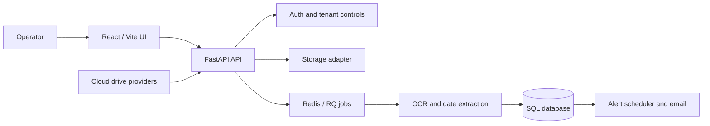

<div align="center">

# DocExpire

### Find expiring documents before they become operational problems.

**A private full-stack document operations system that ingests files, extracts expiration dates, surfaces upcoming risk, and supports scheduled alerts and audit workflows.**

[Architecture](docs/ARCHITECTURE.md) · [Local setup](#running-locally) · [Work with RelayWorks](https://getrelayworks.com/contact/)

  

</div>

> Keep this repository private. It is an implementation reference for confidential document workflows, not a public product or open-source release.

## Business problem

Licenses, certifications, policies, contracts, and identity documents often expire across disconnected folders and cloud drives. Manual spreadsheets miss dates, provide weak audit history, and do not prove whether a document was processed or an alert was sent. DocExpire centralizes ingestion, extraction, review, reporting, and alert operations.

## Key features

- JWT registration, verification, login/logout, and admin role gating
- PDF and image upload with OCR and expiration-date extraction
- Asynchronous processing jobs with UI polling and local eager fallback
- Expiring-soon views, CSV export, optional AI analysis, and audit logs
- Google Drive, Dropbox, and OneDrive OAuth connect/import flows
- Scheduled email alerts and admin-triggered alert runs
- Admin status view, readiness/liveness endpoints, and SMTP test path
- Local profile using SQLite, filesystem storage, fakeredis, and eager jobs
- Production profiles for PostgreSQL, Redis/RQ, and object storage

## Screenshots

No screenshots are committed. This repository handles potentially sensitive documents, so portfolio captures must use generated files and synthetic identities only. See [`docs/SCREENSHOTS.md`](docs/SCREENSHOTS.md) for the approved capture plan.

## Architecture



The local profile collapses external services into SQLite, filesystem storage, fakeredis, and eager execution. Production separates API, worker, scheduler, database, queue, and object storage. See [`docs/ARCHITECTURE.md`](docs/ARCHITECTURE.md).

## Tech stack

- FastAPI, Python 3.11+, SQLAlchemy, Alembic, Pydantic
- React 18, Vite, React Router, Tailwind CSS
- Tesseract OCR and Poppler/pdf2image
- Redis Queue, APScheduler, PostgreSQL or SQLite
- S3, Google Cloud Storage, Azure Blob, or local filesystem adapters
- Google Drive, Dropbox, and Microsoft Graph integrations

## Installation

System prerequisites:

```bash
# macOS
brew install tesseract poppler

# Ubuntu / Debian
sudo apt-get update && sudo apt-get install -y tesseract-ocr poppler-utils
```

Install application dependencies:

```bash
git clone <private-repository-url>
cd document-expiration-tracker-and-alert-system

cd backend
python3.11 -m venv .venv
source .venv/bin/activate
pip install -r requirements.txt -r requirements-dev.txt
cp .env.example .env

cd ../frontend
npm ci
cp .env.example .env
```

## Configuration

The checked-in examples are local-only templates. Replace both application/JWT secrets even for shared development. Production additionally requires a token-encryption key, SMTP, strict hosts/origins, real Redis with async jobs, a production database, and object storage.

Cloud providers remain disabled until their OAuth client, secret, and exact callback URI are configured. Tokens are encrypted at rest; `TOKEN_ENCRYPTION_KEY` is mandatory outside development.

## Running locally

From the repository root:

```bash
cd backend
source .venv/bin/activate
alembic upgrade head
uvicorn main:app --reload
```

In a second terminal:

```bash
cd frontend
npm run dev
```

Open `http://localhost:5173`. On macOS, `./run.sh` starts the API and frontend after dependencies and environment files exist. Local eager jobs do not require a worker.

## Background jobs and alerts

When `RQ_ASYNC=True`, run these as separate processes from `backend/`:

```bash
python worker.py
python scheduler.py
```

Do not start a worker against fakeredis/eager mode; that profile executes work inline.

## Validation

```bash
cd backend && source .venv/bin/activate && pytest -q
cd ../frontend && npm test -- --run && npm run build
```

The last documented validation results and provider boundaries are in [`docs/VALIDATION.md`](docs/VALIDATION.md).

## Deployment

Production requires `APP_ENV=production`, unique encryption/auth secrets, HTTPS behind a reverse proxy, PostgreSQL, real Redis/RQ, durable object storage, restricted hosts/CORS, configured SMTP, and separate API/worker/scheduler processes. Run Alembic migrations before traffic and verify `/healthz`, `/readyz`, the SMTP test, one synthetic document, and one alert cycle.

## Project structure

```text
backend/              FastAPI routes, auth, processing, storage, jobs, and tests
  migrations/         Alembic migration environment and versions
frontend/             React/Vite operations interface and tests
docs/                 Architecture, validation, screenshots, troubleshooting
run.sh                macOS local launcher
```

## Design decisions

- Storage, queue, and database adapters support a low-friction local profile without pretending it is production infrastructure.
- Async processing is the primary UI path; eager execution keeps local setup usable.
- Cloud tokens are encrypted separately from application/JWT secrets.
- SMTP-disabled development returns an honest manual verification path.
- Operational endpoints distinguish liveness from dependency readiness.

## Known limitations

- Live cloud-provider handshakes require real vendor credentials and manual QA.
- OCR and extracted dates require human review for poor scans and complex layouts.
- AI analysis is optional and requires an Anthropic API key; core expiration tracking does not depend on it.
- The repository does not claim regulatory compliance, legal recordkeeping, or guaranteed date accuracy.
- Local SQLite/filesystem/fakeredis mode is not a production deployment profile.

## Roadmap

- Capture a fully synthetic upload-to-alert walkthrough for private sales demonstrations
- Add representative OCR/date fixtures without using real documents
- Exercise each cloud connector against dedicated test tenants
- Add production load and recovery evidence before making scale claims

## License

Private and proprietary. Copyright © 2026 Caleb Rogers. All rights reserved. See [`LICENSE`](LICENSE).

## Work with me

DocExpire demonstrates document ingestion, OCR, background jobs, cloud integrations, alerts, and internal operations tooling. For a custom document workflow, [contact RelayWorks](https://getrelayworks.com/contact/) or review [DevCalebR on GitHub](https://github.com/DevCalebR).
