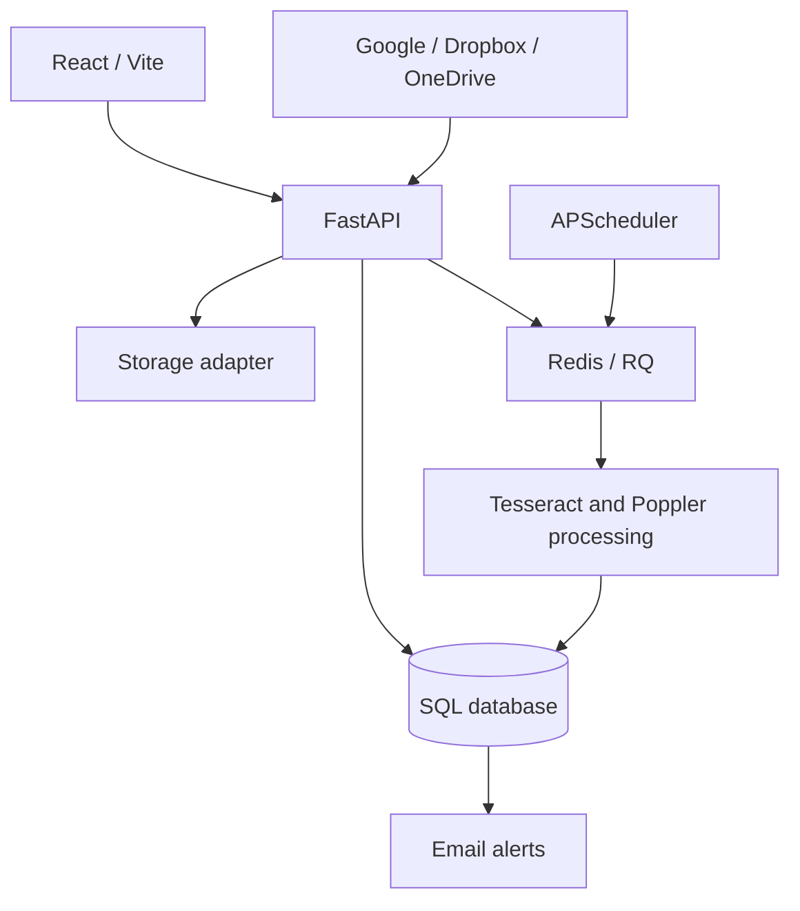

# Architecture

## Runtime profiles

The local profile uses SQLite, filesystem storage, fakeredis, and eager jobs. The production profile uses PostgreSQL, a real Redis/RQ worker, durable object storage, and a separate scheduler.

## Boundaries

- FastAPI owns authentication, authorization, upload validation, cloud callbacks, reports, and operational endpoints.
- Storage adapters keep object persistence separate from document metadata.
- Queue jobs perform OCR/date extraction and persist status for UI polling.
- OAuth tokens use dedicated encryption; provider credentials remain environment secrets.
- React renders API data but does not enforce server authorization.

## Data lifecycle

Uploaded or imported files are assigned server-controlled storage keys. Processing derives text and candidate dates, which remain reviewable records rather than guaranteed facts. Delete behavior removes authorized metadata and nested storage objects. Production retention, backups, and legal hold policies must be defined by the operator.
